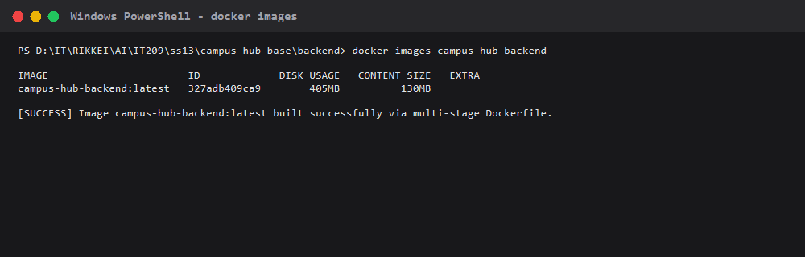
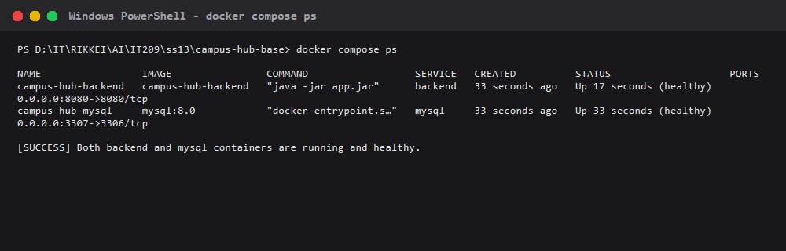
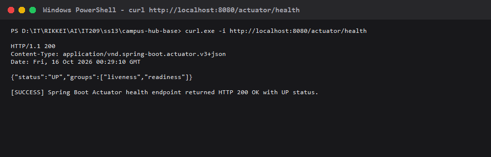

# Campus Hub Base

# BÀI KIỂM TRA ĐẦU GIỜ — ĐÓNG GÓI VÀ CHẠY CAMPUS HUB VỚI DOCKER

## Thông tin sinh viên
- **Họ và tên**: Dương Phúc Thịnh
- **Mã sinh viên**: *(Sinh viên điền mã số sinh viên vào đây)*
- **Bài làm**: Đóng gói và chạy Campus Hub với Docker & Docker Compose

---

## 1. Lệnh dùng để chạy hệ thống

### 1.1. Kiểm thử backend bằng Gradle
```powershell
cd backend
./gradlew.bat test      # Trên Windows
# hoặc ./gradlew test   # Trên Linux / macOS
```

### 1.2. Đóng gói Docker Image cho Backend
```powershell
cd backend
docker build -t campus-hub-backend .
```

### 1.3. Kiểm tra Docker Image vừa tạo
```powershell
docker images campus-hub-backend
```

### 1.4. Khởi động hệ thống với Docker Compose
```powershell
# Chạy từ thư mục gốc của repository
docker compose config
docker compose up -d
```

### 1.5. Kiểm tra trạng thái các service
```powershell
docker compose ps
```

### 1.6. Kiểm tra Endpoint Healthcheck
```powershell
curl -i http://localhost:8080/actuator/health
```

---

## 2. Cổng và URL kiểm tra backend

- **Backend Health Check**: `http://localhost:8080/actuator/health`
- **Backend API Categories**: `http://localhost:8080/api/categories`
- **Cổng công khai Backend**: `8080`
- **Cổng công khai MySQL**: `3307` (được map vào cổng container `3306`, chuỗi kết nối nội bộ giữa Backend và MySQL dùng `jdbc:mysql://mysql:3306/campus_hub`)

---

## 3. Minh chứng kết quả thực hiện

### Minh chứng 1: Docker Image đã build thành công
```text
PS D:\IT\RIKKEI\AI\IT209\ss13\campus-hub-base\backend> docker images campus-hub-backend
IMAGE                       ID             DISK USAGE   CONTENT SIZE   EXTRA
campus-hub-backend:latest   327adb409ca9        405MB          130MB        
```


### Minh chứng 2: Trạng thái các service sau khi chạy Compose
```text
PS D:\IT\RIKKEI\AI\IT209\ss13\campus-hub-base> docker compose ps
NAME                 IMAGE                COMMAND                  SERVICE   CREATED          STATUS                    PORTS
campus-hub-backend   campus-hub-backend   "java -jar app.jar"      backend   33 seconds ago   Up 17 seconds (healthy)   0.0.0.0:8080->8080/tcp, [::]:8080->8080/tcp
campus-hub-mysql     mysql:8.0            "docker-entrypoint.s…"   mysql     33 seconds ago   Up 33 seconds (healthy)   0.0.0.0:3307->3306/tcp, [::]:3307->3306/tcp
```


### Minh chứng 3: Kết quả gọi `/actuator/health` trả về HTTP 200 và trạng thái UP
```http
HTTP/1.1 200 OK
Content-Type: application/vnd.spring-boot.actuator.v3+json

{"status":"UP","groups":["liveness","readiness"]}
```


---

## Giới thiệu dự án gốc


## Chức năng có sẵn

- Xem, tìm kiếm và lọc bài đăng.
- Đăng ký, đăng nhập bằng HTTP Basic.
- Tạo bài đăng theo chuyên mục.
- Bình luận và bày tỏ quan tâm.
- Chủ bài đăng có thể đánh dấu bài đã hoàn tất.
- Quản trị viên có quyền quản lý trạng thái bài đăng qua API.
- Health check tại `/actuator/health`.

Tài khoản mẫu được tạo khi ứng dụng khởi động lần đầu:

| Vai trò | Tên đăng nhập | Mật khẩu |
|---|---|---|
| Sinh viên | `student` | `student123` |
| Quản trị viên | `admin` | `admin123` |

Các tài khoản này chỉ dùng để trình diễn. Nhóm cần thay đổi hoặc loại bỏ trước khi sử dụng trong bối cảnh thực tế.

## Kiến trúc

```text
React frontend
    │ /api
    ▼
Spring Boot monolith
    │ JDBC
    ▼
MySQL
```

Backend gồm năm bảng chính: `users`, `categories`, `posts`, `comments` và `reactions`. Frontend không sử dụng thư viện giao diện hay thư viện quản lý trạng thái để sinh viên dễ đọc mã nguồn.

## Chạy khi phát triển

Tạo database MySQL tên `campus_hub`, sau đó đặt các biến môi trường nếu thông tin kết nối khác giá trị mặc định:

```powershell
$env:DB_URL = "jdbc:mysql://localhost:3306/campus_hub"
$env:DB_USERNAME = "root"
$env:DB_PASSWORD = "your-password"
```

Chạy backend:

```powershell
cd backend
./gradlew.bat bootRun
```

Mở terminal khác để chạy frontend:

```powershell
cd frontend
npm install
npm run dev
```

Frontend phát triển chạy tại `http://localhost:5173` và chuyển tiếp `/api` tới backend tại cổng `8080`.

## API chính

| Phương thức | Đường dẫn | Mục đích | Xác thực |
|---|---|---|---|
| `POST` | `/api/auth/register` | Tạo tài khoản | Không |
| `GET` | `/api/auth/me` | Lấy người dùng hiện tại | Có |
| `GET` | `/api/categories` | Danh sách chuyên mục | Không |
| `GET` | `/api/posts` | Tìm và lọc bài đăng | Không |
| `GET` | `/api/posts/{id}` | Chi tiết bài đăng | Không |
| `POST` | `/api/posts` | Tạo bài đăng | Có |
| `PUT` | `/api/posts/{id}` | Sửa bài của mình | Có |
| `PATCH` | `/api/posts/{id}/status` | Đổi trạng thái | Có |
| `DELETE` | `/api/posts/{id}` | Xóa bài của mình | Có |
| `POST` | `/api/posts/{id}/comments` | Thêm bình luận | Có |
| `POST` | `/api/posts/{id}/reaction` | Bật hoặc tắt quan tâm | Có |

Các API cần xác thực sử dụng header HTTP Basic. Trong môi trường công khai, hệ thống phải được đặt sau HTTPS.

## Kiểm tra trước khi bàn giao

```powershell
cd backend
./gradlew.bat test

cd ../frontend
npm ci
npm run lint
npm run build
```

## Phạm vi cố ý để mở

Dự án nền chưa có tải tệp, thông báo thời gian thực, email, phân trang trên giao diện, lịch sử thay đổi, dashboard và quy trình kiểm duyệt hoàn chỉnh. Nhóm có thể phát triển các hướng này, sửa sâu dự án nền hoặc thay thế toàn bộ công nghệ nếu phù hợp với ý tưởng của mình.

Dự án không cung cấp sẵn Dockerfile, Docker Compose, cấu hình web server hoặc quy trình CI/CD. Phân tích hệ thống và lựa chọn toàn bộ phương án xây dựng, đóng gói, triển khai là công việc của từng nhóm trong Mini Project.
